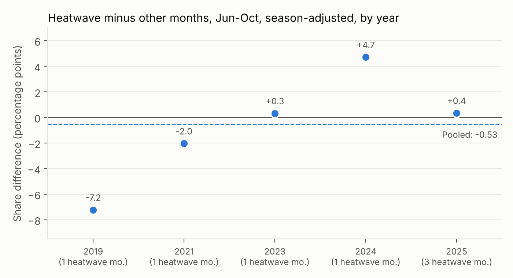

<!-- DRAFT written with an AI assistant. Rewrite in your own words before publishing. Every number below comes from a file in outputs/ or from SESSION_LOG.md. -->
# Jellyfish Temperature Study

Do jellyfish sightings around Puget Sound rise, or appear earlier, when the water runs warm? This project answers that with SQL (DuckDB) on public data: NOAA water temperature and GBIF/iNaturalist jellyfish records, 2019–2025.

## Short answer
**No consistent link was found, and the data cannot rule one out.** In the June–October jellyfish season, months with 5 or more marine heatwave days had a slightly lower effort-corrected jellyfish share than other months (0.1139 vs 0.1321 raw; −0.0053 after adjusting for season and year). The sign of the year-by-year difference flips (2 of 5 years negative, 3 positive), and only 7 heatwave months fall inside the season. This is an association from a small sample, not a cause, and not evidence of no effect.



## Data
| Source | What | Notes |
|---|---|---|
| NOAA CO-OPS (api.tidesandcurrents.noaa.gov) | Hourly water temperature, Tacoma 9446484 (1996–2026), Seattle 9447130 (1996–Jan 2019), Port Townsend 9444900 and Friday Harbor 9449880 as reference stations | Check NOAA's data-use terms before publishing; not verified here. |
| GBIF (api.gbif.org), iNaturalist research-grade dataset | 2,577 jellyfish (class Scyphozoa) records in a Puget Sound box (lat 47.0–48.5, lon −123.2 to −122.2), 2019–2025 | Licences: CC BY-NC 2,339, CC BY 169, CC0 69. Looked up 2026-11-09. Search results have no download DOI. |
| GBIF, same dataset and box | Monthly record counts for a comparison panel: Echinodermata, Decapoda, Phocidae, Otariidae, Cetacea (32,753 records) | Used to correct for how many people were looking. |

Species in the jellyfish records: *Phacellophora camtschatica* 1,473; *Cyanea ferruginea* 952; *Aurelia labiata* 143; *Chrysaora fuscescens* 8; one not identified to species. Names are GBIF accepted names as of the lookup date.

## Method and the SQL behind it
| Question | SQL | Technique |
|---|---|---|
| 1. Data quality | `02_calendar.sql`, `03_dq_suspect_values.sql`, `08_gbif_clean.sql` | hourly calendar spine, anti-join, gaps-and-islands on missing hours, dedupe with `QUALIFY ROW_NUMBER` |
| 2. Baseline | `04_daily.sql`, `05_climatology.sql` | daily means (≥20 valid hours), day-of-year 90th percentile with ±5-day pooling and 31-day circular smoothing (window functions, `quantile_cont`) |
| 3. Heatwave detection | `06_heatwaves.sql` | days above the 90th percentile; events = ≥5 consecutive days (gaps-and-islands) |
| 4. Effort-corrected sightings | `09_effort_monthly.sql` | monthly share = jellyfish / (jellyfish + comparison panel), calendar spine join |
| 5. Heatwave vs normal | `10_monthly_heatwave.sql`, `11_year_comparison.sql` | conditional aggregation, two-way (season and year) adjustment, first-sighting dates with `MIN` and `array_agg` |
| 6. Rankings | `10_monthly_heatwave.sql` | `RANK` over species groups and calendar months |
| 7. Validation | `06_heatwaves.sql`, `07_station_overlap.sql` | event list checked against the 2014–2016 warm period named in the project brief (external check, not verified against the literature here); station cross-checks |

Choices made before looking at jellyfish ratios: heatwave month = ≥5 heatwave days; main season June–October; the comparison panel; and adjusting each month's share for its calendar-month mean and then its year's mean, so the contrast is within a year. That adjustment matters because both observer effort and heatwave days rose after 2022.

## Results
**Heatwaves.** With the primary baseline (Tacoma, 1998–2025 excluding 2007–2017), 66 events and 683 heatwave days were detected; the full-record baseline gives 79 events and 871 days. Events appear from late 2014 through 2016. For 2019–2025 there are 294 heatwave days (by date); only 71 of them fall in June–October, the main jellyfish season.


**Jellyfish.** Raw counts rose from 140 (2019) to 562 (2025), but the comparison panel grew faster (1,250 to 10,775 records), so the effort-corrected share fell from 0.1007 to 0.0496. Share is about 0.7–3% in December–May and about 10–13% in June–October.


**Heatwave vs normal** (`outputs/heatwave_vs_normal_summary.csv`):

| Analysis | Heatwave months | Normal months | Adjusted difference |
|---|---|---|---|
| Jun–Oct, ≥5 days (primary) | 7 | 28 | −0.0053 |
| Jun–Oct, ≥10 days | 3 | 32 | −0.0083 |
| Jun–Oct, any heatwave day | 8 | 27 | −0.0108 |
| All months, ≥5 days | 22 | 62 | −0.0008 |

Species and calendar-month rankings (`outputs/species_shift_ranking.csv`, `month_shift_ranking.csv`) rest on 1–2 heatwave years per month and 23–397 records per species, so they are not reliable. First-sighting dates (`outputs/year_comparison.csv`) track observer effort at least as plausibly as heat: the earliest first sighting from 1 April was 2022-04-07, a year with no heatwave days.

## Data quality (details in `outputs/dq_*.csv`)
- Tacoma hourly: no duplicate rows; 681 missing hours, 678 of them one gap from 1996-12-03 to 1997-01-01; 12,445 null temperatures, all on rows NOAA flagged.
- **Tacoma reads colder than expected in 2007–2017.** Seattle minus Tacoma is within about 0.15 °C in 1996–2006, then 0.25–1.26 °C in 2007–2017. Against Port Townsend and Friday Harbor, Seattle stays roughly steady while Tacoma drops about 1.2–1.4 °C around 2009–2012 and is back to its earlier offset by 2018. The cause is unknown, so those years are excluded from the baseline and results for 2007–2017 should not be trusted.
- Seattle has no data after 2019-01-02, so Tacoma is the main series.
- GBIF jellyfish: 0 duplicates, 0 missing dates or coordinates; coordinate uncertainty is missing on 307 records and above 5,000 m on 163 (kept).

## Limitations
- Citizen-science sightings reflect where and when people look. The comparison panel reduces this bias but does not remove it, counts are records not observers, and the panel's own groups have their own seasons and responses.
- Only seven years of sightings, and only 7 heatwave months in the main season. Months within a year are not independent; no significance tests were run.
- A fixed baseline in a warming sea flags later years more often. Heatwave counts for 2024–2026 should be read with that in mind.
- Station problem in 2007–2017 (above) is unresolved.
- Jellyfish cannot be tested against the 2014–2016 warm period: there are too few records before 2019.
- Not done: lagged heatwave effects and a permutation test.

## Reproduce
```bash
pip install -r requirements.txt
bash run_all.sh        # Linux/macOS; on Windows PowerShell: .\run_all.ps1
```
Downloads about 25 MB into `data/raw/` (git-ignored) and builds `data/jelly.duckdb`. Built and run on Linux with Python 3.13; `run_all.ps1` has not been run yet. Layout: `sql/` numbered queries, `scripts/` download/load/charts only, `outputs/` result CSVs and charts, `SESSION_LOG.md` decisions and checks.

## Credits
NOAA CO-OPS water temperature; GBIF.org occurrence data (iNaturalist research-grade observations, retrieved 2026-11-09), used under each record's licence (CC0, CC BY, CC BY-NC); non-commercial use only.
