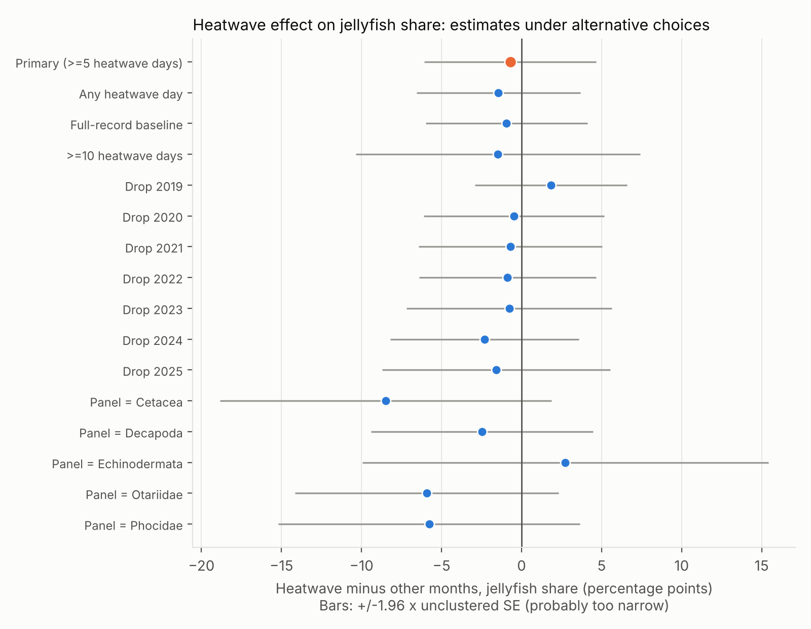
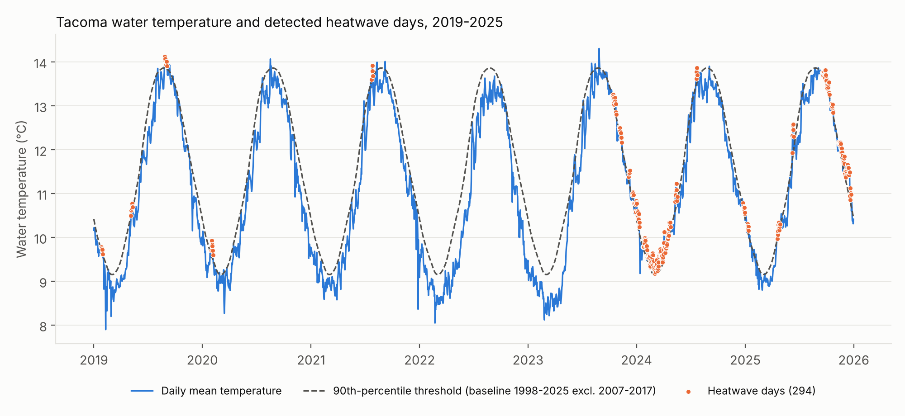
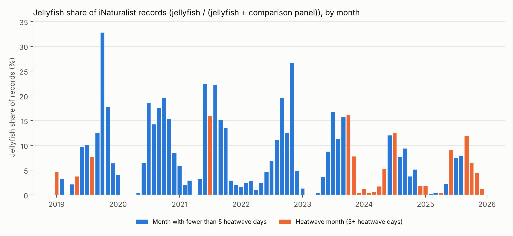

# Jellyfish Temperature Study

Do jellyfish sightings around Puget Sound rise, or appear earlier, when the water runs warm? This project addresses that with SQL (DuckDB) on public data: NOAA water temperature and GBIF/iNaturalist jellyfish records, 2019–2025.

An AI assistant (Claude) assisted with manual, repetitive tasks and code writing.

## Short answer
**No consistent link was found, and the data cannot rule one out.** In the June–October jellyfish season, 7 heatwave months (5 or more heatwave days) are compared with 28 other months. After removing calendar-month and year effects, the heatwave-month estimate is −0.0070 in jellyfish share (−0.7 percentage points; unclustered standard error 0.0274). Raw mean shares are 0.1139 in heatwave months and 0.1321 in the others. The estimate changes sign under reasonable alternatives (dropping 2019 gives +0.0184; using only echinoderms as the comparison group gives +0.0274), and no estimate is more than 1.61 unclustered standard errors from zero. This is an association from a small sample, not a cause, and not evidence of no effect.



## Data
| Source | What | Notes |
|---|---|---|
| NOAA CO-OPS (api.tidesandcurrents.noaa.gov) | Hourly water temperature: Tacoma 9446484 (1996–2026, main series), Seattle 9447130 (1996–Jan 2019), Port Townsend 9444900 and Friday Harbor 9449880 (reference stations) | NOAA states that information on its servers is in the public domain unless annotated otherwise and may be used freely, and requests attribution (tidesandcurrents.noaa.gov/disclaimers.html, read 2026-11-09). |
| GBIF (api.gbif.org), iNaturalist research-grade dataset | 2,577 jellyfish (class Scyphozoa) records in a Puget Sound box (lat 47.0–48.5, lon −123.2 to −122.2), 2019–2025 | Licences: CC BY-NC 2,339, CC BY 169, CC0 69. Looked up 2026-11-09. Observer names were not stored. |
| GBIF, same dataset and box | Monthly record counts for a comparison panel: Echinodermata, Decapoda, Phocidae, Otariidae, Cetacea (32,753 records) | Used as the denominator, to adjust for how many people were looking. |

Species in the jellyfish records: *Phacellophora camtschatica* 1,473; *Cyanea ferruginea* 952; *Aurelia labiata* 143; *Chrysaora fuscescens* 8; one not identified to species. "Jellyfish" here means Scyphozoa only (not hydrozoan medusae). Names are GBIF accepted names as of the lookup date.

## Method and the SQL behind it
| Question | SQL | Technique |
|---|---|---|
| 1. Data quality | `02_calendar.sql`, `03_dq_suspect_values.sql`, `08_gbif_clean.sql` | hourly calendar spine, anti-join, gaps-and-islands on missing hours, dedupe with `QUALIFY ROW_NUMBER` |
| 2. Baseline | `04_daily.sql`, `05_climatology.sql` | daily means (≥20 valid hours), day-of-year 90th percentile with ±5-day pooling and 31-day circular smoothing (window functions, `quantile_cont`) |
| 3. Heatwave detection | `06_heatwaves.sql` | days above the 90th percentile; events = ≥5 consecutive days (gaps-and-islands) |
| 4. Panel-relative sightings (effort adjustment) | `09_effort_monthly.sql` | monthly share = jellyfish / (jellyfish + comparison panel), calendar spine join |
| 5. Heatwave vs normal | `10_monthly_heatwave.sql`, `11_year_comparison.sql`, `12_robustness.sql` | conditional aggregation, two-way (calendar month and year) fixed effects by demeaning with window functions, alternative-choice variants |
| 6. Rankings | `10_monthly_heatwave.sql` | `RANK` over species groups and calendar months |
| 7. Validation | `06_heatwaves.sql`, `07_station_overlap.sql` | event list compared with the 2014–2016 warm period named in the project brief; station cross-checks |

What was fixed before the heatwave contrast was computed: heatwave month = ≥5 heatwave days, the comparison panel, and the within-year adjustment. The June–October season was chosen after seeing that jellyfish are recorded mostly in summer. The estimator in `12_robustness.sql` demeans both the share and the heatwave flag by calendar month and then by year (the panel is balanced, so this equals a regression with month and year dummies). The adjustment matters because observer effort rose every year and 260 of the 294 heatwave days in 2019–2025 fall in 2023–2025.

## Results
**Heatwaves** (`outputs/heatwave_event_summary.csv`). Primary baseline: Tacoma daily means, years 1998–2006 and 2018–2025 (2007–2017 excluded, see data quality). Through 2025 there are 55 events and 510 heatwave days (39 events and 378 days if events in 2007–2017 are left out); the study window 2019–2025 has 25 events and 294 heatwave days, and the longest event is 63 days. Partial 2026 (to 2026-11-08) adds 11 events and 173 days and changes whenever the data are rerun. Under the full-record baseline (1998–2025) the same scopes give 67 events / 674 days, 49 / 498, 30 / 369, and 12 / 197 for 2026. Events appear from December 2014 to November 2016, overlapping the 2014–2016 warm period named in the brief. That is weak validation: Tacoma data in those years are suspect (below), and I did not check the events against the literature.



**Jellyfish.** Raw counts rose from 140 (2019) to 562 (2025), while the comparison panel rose from 1,250 to 10,775 records, so the panel-relative share fell from 0.1007 to 0.0496. Pooled over 2019–2025 (`outputs/effort_by_calendar_month.csv`), the share is 0.7–3.0% from December to May, 8.0% in November and 10.1–13.2% from June to October.



**Is the denominator neutral?** No (`outputs/panel_group_yearly.csv`). Records from 2019 to 2025 grew 10.7× for echinoderms (496 to 5,316), 8.4× for decapods, 4.8× for Phocidae, 4.0× for Otariidae and 5.4× for Cetacea, against 4.0× for jellyfish. The estimate depends on which group is used, which is why the single-group variants are in the figure.

**Heatwave vs normal** (`outputs/robustness_fe_estimates.csv`; June–October, 35 months; estimates are in share units, and the standard error ignores that months within a year are correlated, so it is probably too small):

| Variant | Heatwave months | Estimate | SE |
|---|---|---|---|
| Primary (≥5 days) | 7 | −0.0070 | 0.0274 |
| ≥10 days | 3 | −0.0148 | 0.0453 |
| Any heatwave day | 8 | −0.0144 | 0.0261 |
| Full-record baseline | 12 | −0.0094 | 0.0258 |
| Drop 2019 | 6 | +0.0184 | 0.0242 |
| Panel = Echinodermata only | 7 | +0.0274 | 0.0647 |
| Panel = Cetacea only | 7 | −0.0848 | 0.0528 |

The other leave-one-year-out and single-group variants are in the CSV. The species and calendar-month rankings (`outputs/species_shift_ranking.csv`, `month_shift_ranking.csv`) rest on 1–2 heatwave years per month and 23–397 records per species in heatwave months, so they are not reliable.

**Timing.** First sightings from 1 April fell 6 to 45 days after 1 April, and the 10th record 25 to 82 days after (`outputs/year_comparison.csv`). Timing is not compared between heatwave and other years: the heatwave-year definition (June–October heat) does not describe April sightings. January–April heat was concentrated in 2024 (103 days, against 0 to 16 in other years), and 2024 had the earliest 10th record (April 26). The earliest first sighting was 2022-04-07, a year with no heatwave days. Panel records in April–June rose from 429 (2019) to 4,713 (2025), so timing cannot be separated from effort here.

## Data quality (details in `outputs/dq_*.csv`)
- Tacoma hourly: no duplicate rows; 681 missing hours, 678 of them one gap from 1996-12-03 to 1997-01-01; 12,445 null temperatures, all on rows NOAA flagged.
- **Tacoma reads colder than expected in 2007–2017.** Seattle minus Tacoma is within about 0.15 °C in 1996–2006, then 0.25–1.26 °C in 2007–2017. Against Port Townsend and Friday Harbor, Seattle stays roughly steady while Tacoma drops about 1.2–1.4 °C around 2009–2012 and is back to its earlier offset by 2018. The cause is unknown (`outputs/station_overlap_by_year.csv`, `station_stability_by_year.csv`). Those years are excluded from the baseline, and no heatwave events are detected in 2007–2013, which should not be read as no warm water.
- Seattle has no data after 2019-01-02, so Tacoma is the main series.
- GBIF jellyfish: 0 duplicates, 0 missing dates or coordinates; coordinate uncertainty is missing on 307 records and above 5,000 m on 163 (kept).

## Limitations
- Citizen-science sightings reflect where and when people look. The comparison panel reduces this bias but does not remove it, it is not neutral (above), and counts are records, not observers.
- Only seven years of sightings and 7 heatwave months in the main season. Months within a year are not independent; no significance tests were run, and a permutation test and lagged effects were not done.
- The baseline has 17 years, shorter than the usual 30-year climatology, and 7 of them are the study years themselves, so the tested years help set their own threshold. The method is simplified from Hobday et al. (2016): no gap-bridging between events and a smoothed pooled percentile. If the water has warmed over the baseline period (not tested here), a fixed baseline flags later years more often.
- One Tacoma station stands in for a box about 1.5° of latitude tall, and the 2007–2017 station problem is unresolved.
- Jellyfish cannot be tested against 2014–2016: there are too few records before 2019 (`outputs/gbif_jellyfish_counts_2010_2018.csv`: 14, 17 and 24 records in 2014, 2015 and 2016).
- iNaturalist records are added, re-identified and relicensed over time, so GBIF counts may differ if the pipeline is rerun later. The committed outputs are a snapshot from 2026-11-09. NOAA's feed is live, so 2026 values also change; 2019–2025 temperature results should not.

## Reproduce
```bash
pip install -r requirements.txt
python run_all.py        # Windows, macOS and Linux (also: bash run_all.sh, or .\run_all.ps1 in PowerShell)
```
This downloads about 28 MB into `data/raw/` (git-ignored), builds `data/jelly.duckdb`, runs `sql/01` to `12` in order, and writes `outputs/`. A fresh clone run with `bash run_all.sh` on Linux (Python 3.13) reproduced 22 of 23 result files byte-for-byte; the other differed only in 2026 rows from the live feed. `python run_all.py` has been run on Linux only, and `run_all.ps1` has not been run. Layout: `sql/` numbered queries, `scripts/` download, load and chart code only, `outputs/` result CSVs and charts, `SESSION_LOG.md` decisions and checks.

## Licence and credits
- Code: MIT (see `LICENSE`). The MIT licence covers the code only; the data keep their own terms.
- Water temperature: NOAA National Ocean Service, Center for Operational Oceanographic Products and Services (CO-OPS), tidesandcurrents.noaa.gov, retrieved via api.tidesandcurrents.noaa.gov.
- iNaturalist contributors, iNaturalist (2026). iNaturalist Research-grade Observations. iNaturalist.org. Occurrence dataset https://doi.org/10.15468/ab3s5x accessed via GBIF.org on 2026-11-09. This is the dataset-level citation (the project used a filtered subset through the GBIF search API, not a GBIF download). Records are used under their own licences (CC0, CC BY, CC BY-NC); non-commercial use only.
